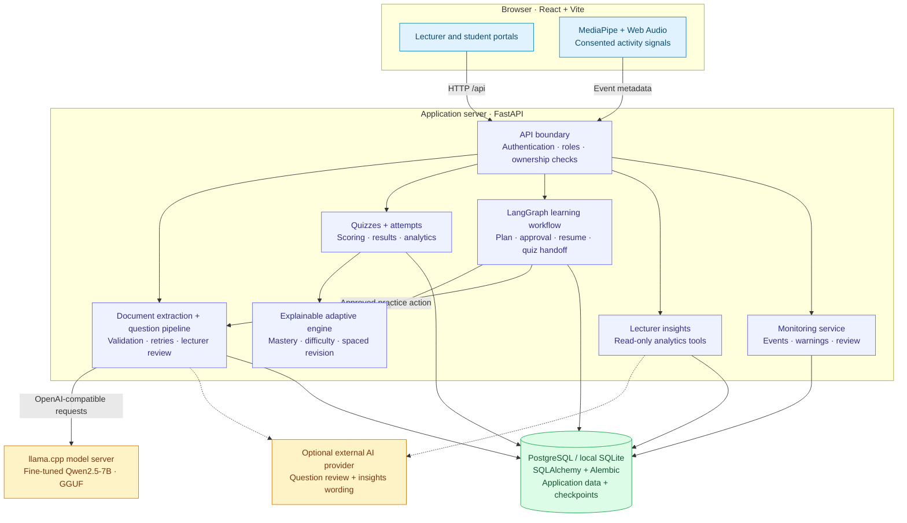
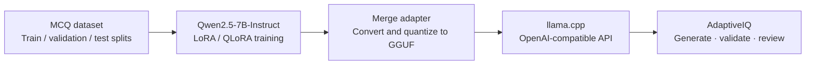

# AdaptiveIQ

### AI-assisted assessment and personalized learning

AdaptiveIQ is a full-stack assessment and personalized learning platform. Lecturers turn study material into reviewed quizzes, see which students left the quiz window during monitored attempts, and find topics the class struggled with. Students take quizzes, see their topic-level progress, and approve personalized practice plans that they can resume later.

**Python · FastAPI · React · Qwen2.5-7B · LoRA · llama.cpp · LangGraph · SQLAlchemy**

[Architecture](adaptiveiq/docs/ARCHITECTURE.md) · [Local setup](adaptiveiq/README.md) · [Training notebook](code/finetune_qwen7b_unsloth.ipynb) · [Evaluation](adaptiveiq/docs/ML_EVALUATION.md) · [API reference](adaptiveiq/docs/API.md)

**[Open the live AdaptiveIQ demo](https://adaptiveiq-demo.onrender.com)**

### Try the lecturer demo

1. Open the live demo and click **Get started** to sign up.
2. Under **I am a**, select **Lecturer**. Enter `AdaptiveIQ-Demo-Local-Only` in the **Lecturer invite code** field, then click **Create account**.
3. Create a demo course and topic, then open **Create a quiz**. Generate and review one question. In **Settings**, enable **Integrity monitoring** and turn on recording when students leave the quiz page, then publish the quiz.
4. In a separate browser profile or incognito window, register as a **Student** and join the course using its join code. Start the quiz after reading the monitoring notice, switch tabs briefly, return, and submit.
5. Back in the lecturer account, open **Quiz → Monitoring → Timeline** for that student's attempt. In the student account, explore **Learning Insights** to see topic evidence and the practice plan workflow. A single question gives you only a small amount of mastery evidence.

This is a shared portfolio demo. Use sample course names and reference material.

The demo runs React, FastAPI, and PostgreSQL on Render. The fine-tuned Qwen model runs on Hugging Face ZeroGPU. The first visit after inactivity may take about a minute while Render starts, and live generation is subject to the Space's GPU quota.

Model weights are supplied separately. This repository contains the application, training notebooks, evaluation artifacts, and deployment configuration.

## The problem we identified

Lecturers spend time turning course material into quiz questions, checking answers, and judging difficulty. During a remote assessment, they also have limited visibility into when a student leaves the quiz page. After submission, a total score gives students little guidance on which concepts to practice next. AdaptiveIQ connects quiz preparation, attempt review, and follow-up practice in the same course.

## How AdaptiveIQ solves it

**For lecturers**, AdaptiveIQ drafts multiple-choice questions from a topic or uploaded study material. It checks question format, duplicates, and supported mathematical answers. Lecturers can edit, approve, or reject drafts before publishing a quiz.

**For students**, AdaptiveIQ uses quiz attempts to update mastery by topic. It recommends what to practice next based on weaker topics, appropriate difficulty, and when a topic is due for review. Lecturers can also use class analytics to see which topics need more attention.

For example, a data structures lecturer can create a quiz from notes on searching and sorting. A student who answers sorting questions correctly but misses binary-search questions can get a targeted recommendation to practice binary search.

## Quiz monitoring and lecturer review

Lecturers can enable monitoring per assigned quiz. Before starting, the student sees what will be recorded and agrees to it. Practice quizzes run without monitoring.

- **Tab and window changes.** If the quiz tab becomes hidden or the quiz window loses focus, AdaptiveIQ records the departure and return. For example, switching to another tab or browser window can create a timeline entry with the time and duration.
- **Fullscreen, camera, and microphone.** Lecturers can record fullscreen exits and optionally enable camera or microphone signals. MediaPipe counts faces in the student's browser, and Web Audio measures speech-like activity there. The server receives event metadata such as timestamps, durations, and face counts. Images, video, and audio stay on the device.
- **Per-student timeline.** The lecturer who owns the quiz can open **Monitoring**, see which student's attempt recorded events, inspect the timeline, and mark it for follow-up or record no concern. Thresholds help prioritize review. The browser cannot identify which website or application the student opened, and monitoring events do not automatically change marks.

[Monitoring design and tests](adaptiveiq/docs/MONITORING.md)

## How I used LangGraph

I used **LangGraph** to manage the student practice workflow across visits. After a student submits a quiz, FastAPI scores the attempt and the adaptive engine updates mastery by topic. The learning graph uses that evidence, difficulty rules, and spaced revision to propose a practice plan and explain the recommended steps.

1. **Build the plan.** Choose practice actions from the student's topic evidence and revision schedule.
2. **Pause for approval.** Save the plan to a SQLAlchemy-backed checkpoint so the student can leave and return later.
3. **Resume and hand off.** When the student approves a step, resume the workflow, recheck access, and hand the approved action to the practice service. When the action calls for a new quiz, Qwen generates the questions.

The mastery and planning rules are deterministic. Qwen handles question generation, and LangGraph handles the plan's state, approval, and handoff. [Learning workflow diagram](adaptiveiq/docs/ARCHITECTURE.md#learning-feedback-and-persistent-plans) · [LangGraph implementation](adaptiveiq/backend/app/agents/personalized_learning.py)

## What the platform does

| Capability | Implementation |
| --- | --- |
| **Generate from study material** | Extracts PDF, DOCX, and TXT content; selects reference passages and generates MCQs with a fine-tuned Qwen model. |
| **Review before publishing** | Checks question structure, duplicates, and mathematical answers; supports optional AI review, bounded retries, and lecturer approval. |
| **Adapt practice to the learner** | Uses weighted Beta-Bernoulli topic mastery, evidence thresholds, difficulty policies, and spaced revision recommendations. |
| **Resume personalized learning plans** | Uses a LangGraph workflow with database checkpoints, explicit student approval, and quiz handoffs. Planning follows deterministic policies. |
| **Explain class performance** | Provides lecturer analytics and a read-only insights agent with anonymized tool results and optional AI wording. |
| **Monitor with consent** | Processes face counts and audio activity in the browser; sends event metadata for lecturer review, without uploading raw camera or microphone recordings. |

## System architecture

The backend coordinates assessment and learning workflows. Qwen generates content, and the adaptive engine computes mastery and recommendations. The diagram shows the local llama.cpp inference path. The live demo calls the Hugging Face ZeroGPU Space from the same backend model service.



Solid arrows show application data and control flow; dashed arrows show optional AI calls. Browser monitoring sends metadata, not raw media. External AI review receives question content and selected source passages; insights use anonymized analytics. SMTP and optional Google Forms integration are described in the [architecture reference](adaptiveiq/docs/ARCHITECTURE.md).

## Model engineering



- **Training:** [Qwen fine-tuning notebook](code/finetune_qwen7b_unsloth.ipynb), using Unsloth and LoRA adapters.
- **Inference:** [GGUF conversion notebook](code/convert_7b_to_gguf_kaggle.ipynb) and a separate llama.cpp server, keeping model weights outside the web API process.
- **Evaluation:** [Committed experiment results](results/) and an [evaluation guide](adaptiveiq/docs/ML_EVALUATION.md) covering generation quality, base-versus-fine-tuned comparisons, and adaptive-engine simulations.

The preliminary 30-item, AI-assisted pilot does **not** establish that fine-tuning outperforms the base 7B model. A controlled, blind human evaluation remains future work. Adaptive-learning results use synthetic students, not a real classroom study.

## Assessment-to-learning loop

1. A lecturer chooses a topic or uploads study material and requests a difficulty mix.
2. Qwen generates draft questions; validation and optional AI review flag problems and trigger bounded retries.
3. The lecturer reviews and publishes the assessment. Student-generated practice follows a separate workflow.
4. Students answer questions; the backend scores attempts and updates the evidence used for learning analytics.
5. Topic mastery and revision policies inform the next practice recommendation or student-approved learning plan.

## Repository layout

```text
adaptiveiq/                    Full-stack application
  backend/                     FastAPI, learning policies, migrations and tests
  frontend/                    React portals, monitoring and browser tests
  docs/                        Architecture, API, evaluation and deployment guides
    verification/              Dated integration and feature checks
  deploy/                      Model-hosting configuration
code/                          Training, conversion and evaluation notebooks
results/                       Committed experiment outputs
btech_mcq_dataset_clean.zip     Dataset archive used by the experiments
PUBLISHING.md                  Future update and deployment workflow
```

Start with the [experiment guide](code/README.md) for the model work or the [results guide](results/README.md) for evaluation evidence. Runtime logs, credentials, local databases, dependencies and model weights are ignored.

## Explore the implementation

| Area | Source |
| --- | --- |
| API and application services | [Routes](adaptiveiq/backend/app/api/) · [Services](adaptiveiq/backend/app/services/) |
| Explainable learning policies | [Adaptive engine](adaptiveiq/backend/app/ml/) |
| Agent workflows and persistence | [Agents](adaptiveiq/backend/app/agents/) |
| Student and lecturer interfaces | [React frontend](adaptiveiq/frontend/src/) |
| Database evolution | [Alembic migrations](adaptiveiq/backend/alembic/versions/) |
| Automated verification | [Backend tests](adaptiveiq/backend/tests/) · [Frontend tests and components](adaptiveiq/frontend/src/components/) · [Browser tests](adaptiveiq/frontend/e2e/) |
| Training and experiments | [Notebooks and scripts](code/) · [Results](results/) |

## Run locally

Start with the [application setup guide](adaptiveiq/README.md). The supplied Windows scripts expect Python 3.11+ and Node.js 22.12+; PostgreSQL is recommended, with SQLite available for local development.

```powershell
git clone https://github.com/bhanug2007-prog/adaptive-quiz-generation-project.git
cd adaptive-quiz-generation-projectdaptiveiq
.\setup_windows.bat
.\start_windows.bat
```

For generation, supply the GGUF model and llama.cpp executable as described in the setup guide, or configure a compatible model endpoint. The website runs at `http://localhost:5173` and the API at `http://localhost:8000` with the default local configuration. Test fixtures support development without the real model.

## Verification and limitations

The repository includes pytest, Vitest, and Playwright suites for API behavior, learning policies, permissions, UI flows, and monitoring. Historical verification is documented in the [QA report](adaptiveiq/docs/QA_REPORT.md), [Groq integration report](adaptiveiq/docs/verification/GROQ_REVIEW_VERIFICATION.md), and [activity-warning report](adaptiveiq/docs/verification/ACTIVITY_WARNINGS_VERIFICATION.md); these are dated records, not live CI status.

- LLM-generated questions still require review; mathematical and AI checks are not guarantees of correctness.
- CPU generation can be slow. Hosting the 7B model requires separate compute planning.
- Monitoring signals support lecturer review and do not establish misconduct.
- Document extraction supports text-based PDFs; scanned documents require OCR, which is not implemented.
- Google Forms integration requires environment-specific validation.

## Documentation

[Setup and tests](adaptiveiq/README.md) · [Architecture](adaptiveiq/docs/ARCHITECTURE.md) · [API](adaptiveiq/docs/API.md) · [Evaluation](adaptiveiq/docs/ML_EVALUATION.md) · [Monitoring](adaptiveiq/docs/MONITORING.md) · [Deployment](adaptiveiq/docs/DEPLOYMENT.md) · [Publishing future updates](PUBLISHING.md)

