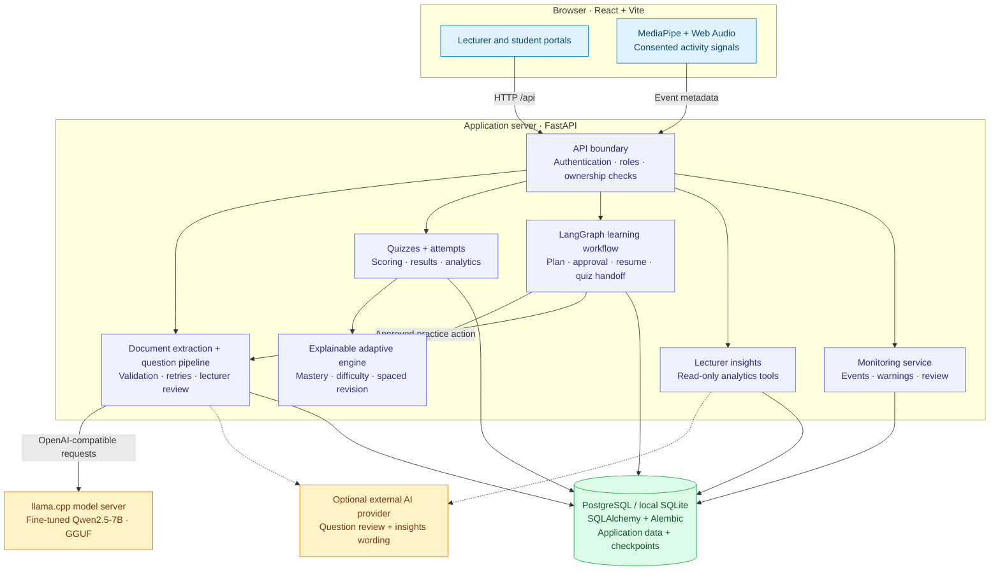
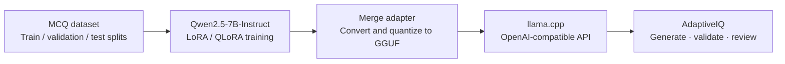

# AdaptiveIQ

### AI-assisted assessment and personalized learning

AdaptiveIQ connects **LLM question generation**, **lecturer review**, and **explainable learning recommendations** in one full-stack application. Lecturers create assessments from topics or study material; students complete quizzes, track topic mastery, and follow personalized practice plans.

**Python · FastAPI · React · Qwen2.5-7B · LoRA · llama.cpp · LangGraph · SQLAlchemy**

[Architecture](adaptiveiq/docs/ARCHITECTURE.md) · [Local setup](adaptiveiq/README.md) · [Training notebook](code/finetune_qwen7b_unsloth.ipynb) · [Evaluation](adaptiveiq/docs/ML_EVALUATION.md) · [API reference](adaptiveiq/docs/API.md)

> **Project status:** Developed and demonstrated locally. Cloud deployment is not yet verified. Model weights are supplied separately; this repository contains the application, training notebooks, evaluation artifacts, and deployment configuration.

## The problem

Creating useful quizzes takes more than generating text: questions need valid answers, appropriate difficulty, review, and a feedback loop. AdaptiveIQ combines those steps so assessment results can guide what a student practices next.

## What the platform does

| Capability | Implementation |
| --- | --- |
| **Generate from study material** | Extracts PDF, DOCX, and TXT content; selects reference passages and generates MCQs with a fine-tuned Qwen model. |
| **Review before publishing** | Checks question structure, duplicates, and mathematical answers; supports optional AI review, bounded retries, and lecturer approval. |
| **Adapt practice to the learner** | Uses weighted Beta-Bernoulli topic mastery, evidence thresholds, difficulty policies, and spaced revision recommendations. |
| **Resume personalized learning plans** | Uses a LangGraph workflow with database checkpoints, explicit student approval, and quiz handoffs. Planning follows deterministic policies. |
| **Explain class performance** | Provides lecturer analytics and a read-only insights agent with anonymized tool results and optional AI wording. |
| **Monitor with consent** | Processes face counts and audio activity in the browser; sends event metadata for lecturer review, without uploading raw camera or microphone recordings. |

## System architecture

The backend coordinates assessment and learning workflows. Qwen generates content; the adaptive engine computes mastery and recommendations separately.



Solid arrows show application data and control flow; dashed arrows show optional AI calls. Browser monitoring sends metadata, not raw media. External AI review receives question content and selected source passages; insights use anonymized analytics. SMTP and optional Google Forms integration are described in the [architecture reference](adaptiveiq/docs/ARCHITECTURE.md).

## Model engineering



- **Training:** [Qwen fine-tuning notebook](code/finetune_qwen7b_unsloth.ipynb), using Unsloth and LoRA adapters.
- **Inference:** [GGUF conversion notebook](code/convert_7b_to_gguf_kaggle.ipynb) and a separate llama.cpp server, keeping model weights outside the web API process.
- **Evaluation:** [Committed experiment results](results/) and an [evaluation guide](adaptiveiq/docs/ML_EVALUATION.md) covering generation quality, base-versus-fine-tuned comparisons, and adaptive-engine simulations.

The preliminary 30-item, AI-assisted pilot does **not** establish that fine-tuning outperforms the base 7B model. A controlled, blind human evaluation remains future work. Adaptive-learning results use synthetic students, not a real classroom study.

## Assessment-to-learning loop

1. A lecturer chooses a topic or uploads study material and requests a difficulty mix.
2. Qwen generates draft questions; validation and optional AI review flag problems and trigger bounded retries.
3. The lecturer reviews and publishes the assessment. Student-generated practice follows a separate workflow.
4. Students answer questions; the backend scores attempts and updates the evidence used for learning analytics.
5. Topic mastery and revision policies inform the next practice recommendation or student-approved learning plan.

## Explore the implementation

| Area | Source |
| --- | --- |
| API and application services | [Routes](adaptiveiq/backend/app/api/) · [Services](adaptiveiq/backend/app/services/) |
| Explainable learning policies | [Adaptive engine](adaptiveiq/backend/app/ml/) |
| Agent workflows and persistence | [Agents](adaptiveiq/backend/app/agents/) |
| Student and lecturer interfaces | [React frontend](adaptiveiq/frontend/src/) |
| Database evolution | [Alembic migrations](adaptiveiq/backend/alembic/versions/) |
| Automated verification | [Backend tests](adaptiveiq/backend/tests/) · [Frontend tests and components](adaptiveiq/frontend/src/components/) · [Browser tests](adaptiveiq/frontend/e2e/) |
| Training and experiments | [Notebooks and scripts](code/) · [Results](results/) |

## Run locally

Start with the [application setup guide](adaptiveiq/README.md). The supplied Windows scripts expect Python 3.11+ and Node.js 22.12+; PostgreSQL is recommended, with SQLite available for local development.

```powershell
git clone https://github.com/bhanug2007-prog/adaptive-quiz-generation-project.git
cd adaptive-quiz-generation-projectdaptiveiq
.\setup_windows.bat
.\start_windows.bat
```

For generation, supply the GGUF model and llama.cpp executable as described in the setup guide, or configure a compatible model endpoint. The website runs at `http://localhost:5173` and the API at `http://localhost:8000` with the default local configuration. Test fixtures support development without the real model.

## Verification and limitations

The repository includes pytest, Vitest, and Playwright suites for API behavior, learning policies, permissions, UI flows, and monitoring. Historical verification is documented in the [QA report](adaptiveiq/docs/QA_REPORT.md), [Groq integration report](adaptiveiq/GROQ_REVIEW_VERIFICATION.md), and [activity-warning report](adaptiveiq/ACTIVITY_WARNINGS_VERIFICATION.md); these are dated records, not live CI status.

- LLM-generated questions still require review; mathematical and AI checks are not guarantees of correctness.
- CPU generation can be slow. Hosting the 7B model requires separate compute planning.
- Monitoring signals support lecturer review and do not establish misconduct.
- Document extraction supports text-based PDFs; scanned documents require OCR, which is not implemented.
- Deployment configuration and Google Forms integration require environment-specific validation.

## Documentation

[Setup and tests](adaptiveiq/README.md) · [Architecture](adaptiveiq/docs/ARCHITECTURE.md) · [API](adaptiveiq/docs/API.md) · [Evaluation](adaptiveiq/docs/ML_EVALUATION.md) · [Monitoring](adaptiveiq/docs/MONITORING.md) · [Deployment](adaptiveiq/docs/DEPLOYMENT.md) · [Publishing future updates](PUBLISHING.md)

## Academic context

A DSAI team project at **IIIT Dharwad**, guided by **Dr. Utkarsh Mahadeo Khaire**. Training notebooks, application code, and evaluation records are linked above so the engineering work can be inspected directly.
