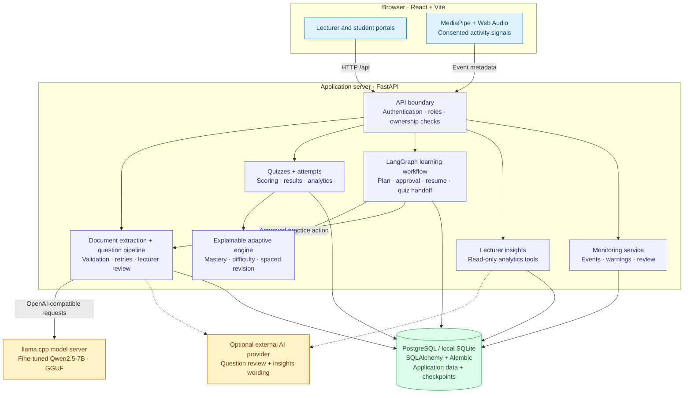
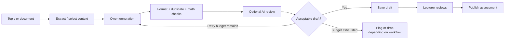
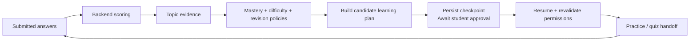

# AdaptiveIQ architecture

[Project overview](../../README.md) · [Local setup](../README.md) · [API reference](API.md)

## System boundary

The backend coordinates assessment and learning workflows. Qwen generates content; the adaptive engine computes mastery and recommendations separately.

Solid arrows show application data and control flow; dashed arrows show optional AI calls. Browser monitoring sends metadata, not raw media. External AI review receives question content and selected source passages; insights use anonymized analytics. SMTP and optional Google Forms integration are described in the [integration details below](#persistence-and-external-integrations).

## Components and responsibilities

| Component | Responsibility | Boundary |
| --- | --- | --- |
| React frontend | Lecturer and student workflows, charts, consent and monitoring controls | Calls the application API; does not load the Qwen model or hold provider credentials. |
| FastAPI routes | Authentication, role/ownership checks, request validation and workflow entry points | Enforces access on the server, independent of UI visibility. |
| Document service | Extracts and chunks PDF, DOCX and TXT material | Uses temporary user-scoped storage; no OCR for scanned PDFs. |
| Question Quality Agent | Coordinates generation, validation, retries and draft persistence | Lecturer approval and publication remain separate actions. |
| Model service | Calls llama.cpp through an OpenAI-compatible endpoint | The model process has no direct application-database access. |
| Quality reviewer | Optional external AI assessment of generated questions | Selected question/source content leaves the application server when enabled. |
| Adaptive engine | Weighted Beta-Bernoulli mastery, evidence thresholds, difficulty and revision policies | Computes learning estimates without asking an LLM to score mastery. |
| Personalized learning workflow | Builds a plan, pauses for student approval, resumes and hands off to practice | Uses LangGraph with SQLAlchemy-backed checkpoints and authorization revalidation. |
| Lecturer Insights Agent | Queries course-scoped analytics and optionally asks AI to word findings | Tools are read-only; provider-facing student identifiers are anonymized. |
| Monitoring service | Stores consented metadata, deduplicates events, tracks warnings and supports lecturer review | No raw camera/microphone upload; warnings do not automatically change marks. |
| SQLAlchemy + Alembic | Application persistence and schema migrations | PostgreSQL for production configuration; SQLite for local development. |

## Question generation and publication

Lecturer drafts can retain failed questions with visible flags for correction. Practice and regeneration have separate acceptance rules. Generation logs record tool calls and retry decisions; a successful AI review does not itself approve or publish a question.

The reviewer is configurable through the legacy `GROK_*` settings. The local Groq integration has a [dated verification report](verification/GROQ_REVIEW_VERIFICATION.md); the variable name should not be read as proof that every run uses xAI. Missing credentials and provider failures are surfaced, with fallback behavior described in the [quality guide](QUALITY_REVIEW.md).

## Learning feedback and persistent plans

Mastery weights reflect answer recency, difficulty and repeated exposure. Low evidence remains explicitly labeled; a high percentage from a tiny sample is not treated as strong mastery. The planning graph uses deterministic policy logic. Practice execution can invoke the question-generation service, which is a separate model call from planning.

Implementation: [mastery](../backend/app/ml/mastery.py), [personalized learning graph](../backend/app/agents/personalized_learning.py), [checkpoint saver](../backend/app/agents/checkpoint_saver.py), and [learning service](../backend/app/services/learning_agent_service.py).

## Persistence and external integrations

The database stores users and course enrollment, subjects/units/topics, questions and quizzes, attempts and answers, results, agent audit records, monitoring events, and learning-plan state. [Alembic migrations](../backend/alembic/versions/) define the evolving schema.

| Integration | Purpose | Status / boundary |
| --- | --- | --- |
| llama.cpp / compatible model server | Qwen question generation | Separate process or host; GGUF weights are not committed. |
| Optional AI reviewer | Question review and insights wording | Backend credentials only; provider calls require network access. |
| SMTP | Verification and password-reset email | Deployment-specific credentials; development delivery behavior differs. |
| Google Forms | Optional quiz export | OAuth configuration and external validation required; see [integration guide](GOOGLE_FORMS.md). |

## Monitoring and security boundaries

- Consent gates monitored assessment attempts. MediaPipe face detection and Web Audio analysis run in the browser; the backend receives event metadata.
- Session cookies, CSRF checks, role checks and ownership checks protect API workflows. Answer visibility depends on the caller and feedback-release rules.
- Password-reset tokens and lecturer invitation settings remain backend concerns. Real configuration values belong in environment settings, not Git.
- Mathematical validation treats generated code as untrusted. The implementation uses a restricted expression path and isolated workers with platform-dependent resource controls; see [mathcheck.py](../backend/app/validators/mathcheck.py) for current behavior.
- Activity warnings are review signals. They do not establish identity or misconduct and do not automatically fail a student.

## Deployment shape

The repository includes [Docker Compose](../docker-compose.yml) for the application stack and [provider-specific model-hosting configuration](../deploy/). A deployed setup needs HTTPS, production database configuration, secrets, database migrations, and a reachable model service. Those files represent deployment support, not proof of a live production deployment.

See [deployment instructions](DEPLOYMENT.md), [evaluation limitations](ML_EVALUATION.md), and [publishing future updates](../../PUBLISHING.md).
